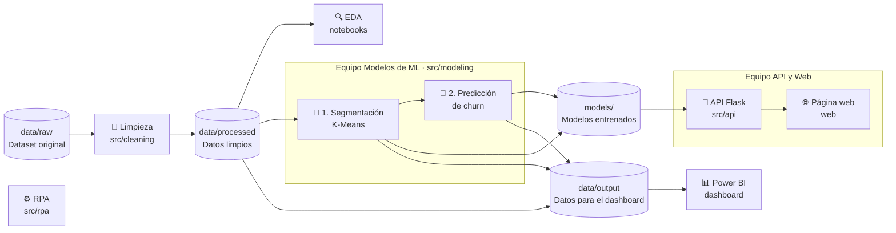
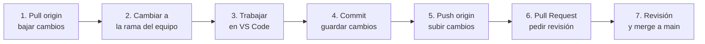

<div align="center">

# 📉 Customer Churn Analysis

**Predicción de abandono de clientes: de los datos crudos a una aplicación web**

Proyecto final · Técnico en Ciencia de Datos · Talendig


</div>

---

## 📑 Contenido

- [Sobre el proyecto](#-sobre-el-proyecto)
- [Flujo del proyecto](#-flujo-del-proyecto)
- [Equipos](#-equipos)
- [Estructura de carpetas](#-estructura-de-carpetas)
- [Instalación](#-instalación)
- [Cómo ejecutar](#-cómo-ejecutar)
- [Cómo colaborar](#-cómo-colaborar)
- [Convenciones](#-convenciones)
- [Contratos entre equipos](#-contratos-entre-equipos)
- [Problemas comunes](#-problemas-comunes)
- [Integrantes](#-integrantes)

---

## 📌 Sobre el proyecto

El **churn** es el porcentaje de clientes que dejan de usar un servicio. Retener un cliente cuesta mucho menos que conseguir uno nuevo, así que saber **quién está en riesgo de irse** permite actuar a tiempo.

En este proyecto vamos a:

1. **Limpiar** el dataset de clientes.
2. **Explorar** los datos (EDA) para entender qué factores se relacionan con el abandono.
3. **Segmentar a los clientes con K-Means** (aprendizaje no supervisado): el modelo agrupa a los clientes que se parecen, sin saber quién se fue. Después vemos cuánto abandono hay en cada grupo.
4. **Entrenar modelos de Machine Learning** (aprendizaje supervisado) que predigan si un cliente se va a ir.
5. **Exponer los modelos en una API** hecha con Flask.
6. **Construir una página web** donde se pueda consultar la predicción y el segmento de cada cliente.
7. **Crear un dashboard en Power BI** con los hallazgos y los segmentos.
8. **Automatizar tareas con RPA** en Python.

### 🗂️ Dataset

Usamos **[Telco Customer Churn](https://www.kaggle.com/datasets/blastchar/telco-customer-churn)** (Kaggle), datos de ejemplo de IBM de una empresa ficticia de telecomunicaciones.

| | |
|---|---|
| **Clientes (filas)** | 7,043 |
| **Columnas** | 21 |
| **Variable objetivo** | `Churn`: si el cliente se fue en el último mes (`Yes` / `No`) |
| **Archivo** | `data/raw/WA_Fn-UseC_-Telco-Customer-Churn.csv` |

Cada cliente tiene información de:

- 📞 **Servicios contratados:** teléfono, líneas múltiples, internet, seguridad en línea, respaldo, protección de dispositivos, soporte técnico y streaming.
- 💳 **Cuenta:** antigüedad (`tenure`), tipo de contrato, facturación electrónica, método de pago, cargo mensual y cargo total.
- 👤 **Datos demográficos:** género, si es adulto mayor, si tiene pareja y si tiene dependientes.

---

## 🔄 Flujo del proyecto



> [!NOTE]
> **Primero se segmenta y después se predice.** K-Means es aprendizaje **no supervisado**: agrupa a los clientes que se parecen sin mirar la columna `Churn`. Esos grupos (segmentos) sirven para entender a los clientes y decidir qué hacer con cada uno. Después, el modelo de churn, que es aprendizaje **supervisado**, aprende de la columna `Churn` a predecir quién se va.
>
> La tarea que va a automatizar el equipo de RPA está por definir. Cuando se decida, se conecta en este diagrama.

---

## 👥 Equipos

Cada equipo trabaja **en su carpeta** y **en su rama**. Así nadie pisa el trabajo de otro.

| Equipo | Carpeta | Rama | Entrega |
|---|---|---|---|
| 🧹 Limpieza y 🔍 EDA | `src/cleaning/` y `notebooks/` | `cleaning-eda` | Datos limpios en `data/processed/` y notebooks con el análisis y los hallazgos |
| 🤖 Modelos de ML | `src/modeling/` | `modeling` | Dos modelos en `models/`: primero, la segmentación de clientes con K-Means; después, el modelo que predice el churn |
| 🔌 API y 🌐 Web | `src/api/` y `web/` | `api-web` | API en Flask que devuelve predicciones y página en HTML/CSS/JS que la consume |
| 📊 Dashboard | `dashboard/` | `dashboard` | Archivo `.pbix` de Power BI |
| ⚙️ RPA | `src/rpa/` | `rpa` | Bot de automatización en Python |

> [!TIP]
> El plan del equipo API y Web (qué vamos a construir, en qué fases y quién hace qué) está en [`docs/plan-api-web.md`](docs/plan-api-web.md).
>
> El avance, los criterios y los pendientes del equipo de Limpieza y EDA están en [`docs/plan-cleaning-eda.md`](docs/plan-cleaning-eda.md).

---

## 📁 Estructura de carpetas

```
customer-churn-analysis/
├── README.md           ← este archivo
├── requirements.txt    ← librerías de Python con versiones fijas
├── .env.example        ← plantilla de variables de entorno
├── data/
│   ├── raw/            ← dataset original (no se modifica nunca)
│   ├── processed/      ← datos limpios
│   └── output/         ← datos para Power BI y resultados
├── notebooks/          ← EDA y experimentos (cada persona los suyos)
├── src/
│   ├── cleaning/       ← scripts de limpieza
│   ├── modeling/       ← código de la segmentación (K-Means) y del modelo de churn
│   ├── api/            ← API en Flask
│   └── rpa/            ← automatización en Python
├── models/             ← modelos ya entrenados: segmentación y churn (.pkl / .joblib)
├── dashboard/          ← archivo .pbix de Power BI
├── web/                ← página web (HTML, CSS, JS)
├── assets/             ← imágenes y documentos del proyecto
├── docs/               ← planes de trabajo y guías (como la de Git)
└── tests/              ← pruebas automáticas
```

> [!TIP]
> `src/modeling/` tiene el **código** que entrena los modelos. `models/` guarda los **modelos ya entrenados**. No los confundas.

---

## 🚀 Instalación

### 1. Instala las herramientas (una sola vez)

| Herramienta | Para qué sirve | Descarga |
|---|---|---|
| **Python 3.14** | Correr el código del proyecto | [python.org/downloads](https://www.python.org/downloads/) |
| **Git** | Control de versiones | [git-scm.com](https://git-scm.com/downloads) |
| **GitHub Desktop** | Usar Git con botones, sin terminal | [desktop.github.com](https://desktop.github.com/) |
| **VS Code** | Editor de código y notebooks | [code.visualstudio.com](https://code.visualstudio.com/) |
| **Power BI Desktop** | Solo el equipo de dashboard | Microsoft Store |

> [!IMPORTANT]
> Al instalar Python en Windows, marca la casilla **"Add python.exe to PATH"** en la primera pantalla del instalador.

### 2. Descarga (clona) el proyecto

1. Abre **GitHub Desktop** e inicia sesión con tu cuenta de GitHub.
2. Ve a **File → Clone repository → URL**.
3. Pega la dirección del repo: `https://github.com/HeymichaelRD/customer-churn-analysis`
4. Elige en qué carpeta de tu computadora guardarlo y haz clic en **Clone**.
5. Haz clic en **Open in Visual Studio Code**.

### 3. Crea tu ambiente virtual e instala las librerías

En VS Code abre una terminal (**Terminal → New Terminal**) y ejecuta los comandos según tu sistema:

<details open>
<summary><b>🪟 Windows (PowerShell)</b></summary>

```powershell
# Crear el ambiente virtual (solo la primera vez)
py -3.14 -m venv .venv

# Activarlo (cada vez que abras una terminal nueva)
.venv\Scripts\Activate.ps1

# Instalar las librerías
pip install -r requirements.txt

# Crear tu archivo de configuración
copy .env.example .env
```

</details>

<details>
<summary><b>🍎 Mac / 🐧 Linux</b></summary>

```bash
# Crear el ambiente virtual (solo la primera vez)
python3.14 -m venv .venv

# Activarlo (cada vez que abras una terminal nueva)
source .venv/bin/activate

# Instalar las librerías
pip install -r requirements.txt

# Crear tu archivo de configuración
cp .env.example .env
```

</details>

✅ Sabrás que el ambiente está activo porque la terminal muestra **`(.venv)`** al principio de la línea.

> [!TIP]
> Si alguien agrega una librería nueva a `requirements.txt`, vuelve a correr `pip install -r requirements.txt` después de descargar los cambios.

---

## 💻 Cómo ejecutar

> Activa siempre el ambiente virtual antes de correr cualquier cosa.

**Notebooks (EDA y experimentos)**

Abre el `.ipynb` en VS Code y, arriba a la derecha, en **Select Kernel**, elige el Python de **`.venv`**.
También puedes usar Jupyter en el navegador:

```bash
jupyter notebook
```

**API (Flask)**

```bash
flask --app src/api/app run
```

La API queda disponible en `http://localhost:5000`. Para comprobar que está encendida, abre `http://localhost:5000/health` en el navegador: debe responder `{"status": "ok", ...}`.

**Página web**

Con la API corriendo, abre otra terminal:

```bash
python -m http.server 8000 --directory web
```

Luego abre `http://localhost:8000` en el navegador. Arriba a la derecha verás si la página está conectada con la API (punto verde) o no (punto rojo).

**Pruebas**

```bash
pytest
```

---

## 🤝 Cómo colaborar

> [!TIP]
> ¿Primera vez con Git? Lee la **[Guía de Git del proyecto](docs/guia-git.md)**: qué es Git, para qué sirve y los comandos esenciales para colaborar, con ejemplos de este proyecto.

### Reglas de oro

1. 🚫 **Nunca trabajes directo en `main`.** Trabaja siempre en la rama de tu equipo.
2. ⬇️ **Antes de empezar, descarga los últimos cambios** (*Fetch origin* → *Pull origin*).
3. 📂 **Trabaja solo en la carpeta de tu equipo.** Si necesitas algo de otra carpeta, habla con ese equipo.
4. 📓 **Cada persona tiene sus propios notebooks.** Nunca edites el notebook de otra persona.
5. 💾 **Haz commits pequeños y seguido**, con un mensaje que explique qué hiciste.
6. 🔐 **Nunca subas contraseñas.** Van en tu `.env`, que no se sube.
7. 📦 **Solo el responsable sube** los datos oficiales (`data/processed/`, `data/output/`), los modelos (`models/`) y el `.pbix`. Para tus pruebas usa una carpeta `tmp/`, que Git ignora.

### Paso a paso con GitHub Desktop



1. **Bajar cambios:** clic en **Fetch origin** y luego en **Pull origin**.
2. **Cambiar de rama:** en **Current branch**, elige la rama de tu equipo (por ejemplo `cleaning-eda`).
3. **Actualizar tu rama con `main`:** menú **Branch → Update from main**. Así tienes lo último que aprobaron los otros equipos.
4. **Trabajar:** haz tus cambios en VS Code.
5. **Commit:** en GitHub Desktop revisa los archivos de la izquierda (desmarca los que no quieras subir), escribe un resumen abajo y clic en **Commit to `<tu-rama>`**.
6. **Subir:** clic en **Push origin**.
7. **Pull Request:** clic en **Preview Pull Request** (o **Create Pull Request**, según tu versión). Se abre GitHub en el navegador: describe qué hiciste y clic en **Create pull request**.
8. **Revisión:** Michael (mantenedor del repo) revisa y, si todo está bien, lo une a `main` (*merge*).

### Mensajes de commit

Escribe en español, en presente, empezando con el área:

```
cleaning: elimina clientes duplicados
eda: agrega gráfico de churn por tipo de contrato
api: crea endpoint /predict
```

<details>
<summary><b>📖 Glosario de Git para principiantes</b></summary>

| Término | Qué significa |
|---|---|
| **Repositorio (repo)** | La carpeta del proyecto con todo su historial de cambios. |
| **Clonar** | Descargar el repo de GitHub a tu computadora. |
| **Commit** | Una "foto" de tus cambios, con un mensaje que explica qué hiciste. |
| **Rama (branch)** | Una copia paralela del proyecto donde puedes trabajar sin afectar `main`. |
| **`main`** | La rama principal, con la versión aprobada del proyecto. |
| **Push** | Subir tus commits a GitHub. |
| **Pull** | Bajar a tu computadora los cambios que otros subieron. |
| **Pull Request (PR)** | Una solicitud para unir tu rama a `main`, que otra persona revisa. |
| **Mantenedor (maintainer)** | La persona que revisa los Pull Requests y los une a `main`. |
| **Merge** | Unir los cambios de una rama con otra. |
| **Conflicto** | Cuando dos personas cambiaron la misma parte de un archivo y Git no sabe cuál dejar. |

</details>

---

## 📏 Convenciones

- **Idioma:** el código (variables, funciones, archivos) va en **inglés**, igual que las columnas del dataset. Los comentarios, notebooks y documentación van en **español**.

  ```python
  # Convertimos el cargo total a número; los valores en blanco quedan como NaN
  raw_df["TotalCharges"] = pd.to_numeric(raw_df["TotalCharges"], errors="coerce")
  ```

- **Nombres de archivos y carpetas:** sin tildes, sin ñ y sin espacios. Usa guion bajo: `clean_data.py`, no `clean data.py`.
- **Notebooks:** `NN_tema_nombre.ipynb`. Por ejemplo: `01_cleaning_juan.ipynb`, `02_eda_maria.ipynb`.
- **Datos originales:** lo que está en `data/raw/` **no se modifica nunca**. La limpieza genera archivos nuevos en `data/processed/`.
- **Librerías nuevas:** se agregan a `requirements.txt` con su versión fija (`nombre==X.Y.Z`).

---

## 📜 Contratos entre equipos

Lo que cada equipo **entrega** al siguiente. Con esto definido, todos pueden trabajar en paralelo sin esperarse.

| Entrega | De → Para | Archivo / endpoint | Estado |
|---|---|---|---|
| Datos limpios | Limpieza y EDA → Modelos | `data/processed/telco_churn_clean.csv` (lo genera `src/cleaning/clean_data.py`) | Listo |
| Segmentación de clientes | Modelos → API, Power BI | `models/telco_customer_segments.joblib` y `models/segments_info.json` (K-Means, k=4) | Listo; la API ya lo usa |
| Modelo de churn | Modelos → API | `models/telco_churn_logistic.joblib` (regresión logística, 12 campos) y `models/churn_model_info.json` (umbral `0.325`) | Listo; la API ya lo usa |
| Datos para el dashboard | Limpieza y EDA, Modelos → Power BI | `data/output/telco_churn_dashboard.csv` (lo genera `src/cleaning/clean_data.py`). Modelos agrega la columna `segment` uniendo por `customerID` | Parte de Limpieza y EDA lista; falta el segmento de Modelos |
| Predicción | API → Web | `GET /health` y `POST /predict` | v3: 12 campos, con la regresión logística y el segmento (abajo) |

<details>
<summary><b>🧩 Segmentación de clientes (borrador)</b></summary>

El profesor pidió que, **antes** del modelo de churn, el equipo de Modelos segmente a los clientes con **K-Means**. Los segmentos sirven para describir a los clientes y decidir qué hacer con cada grupo: se muestran en el dashboard y en la página web, y ayudan a elegir las recomendaciones de retención.

| Qué | Detalle |
|---|---|
| **Modelo** | Un `Pipeline` de scikit-learn (escalado + one-hot + `KMeans`) guardado con `joblib` en `models/`. Recibe las columnas originales del dataset y, con `predict`, devuelve el número de segmento de cada cliente |
| **Columnas** | Las elige el equipo de Modelos. **Nunca** `Churn`, porque es aprendizaje no supervisado, ni `customerID` |
| **Número de segmentos (k)** | Se elige con el método del codo y con la silueta. El notebook muestra los dos gráficos |
| **Que se pueda repetir** | `random_state` fijo (por ejemplo, `42`), para que al volver a entrenar salgan los mismos grupos |
| **Nombres** | En `models/segments_info.json`, cada segmento con un nombre corto, una descripción, cuántos clientes tiene y su tasa de abandono. Los números (0, 1, 2…) no dicen nada por sí solos y pueden cambiar si se vuelve a entrenar |
| **Para Power BI** | El segmento de cada cliente (`customerID` y `segment`) en el CSV de `data/output/` |

Ejemplo de `models/segments_info.json` (los valores son ilustrativos):

```json
{
  "algorithm": "KMeans",
  "k": 4,
  "columns": ["tenure", "MonthlyCharges"],
  "segments": [
    {
      "id": 0,
      "name": "Nuevos con cargo alto",
      "description": "Poco tiempo en la empresa y un cargo mensual alto",
      "customers": 2204,
      "churn_rate": 0.49
    }
  ]
}
```

> [!IMPORTANT]
> Escalen los datos antes de K-Means (`StandardScaler`). K-Means agrupa por distancias: sin escalar, una columna con números grandes, como `TotalCharges`, decide sola los grupos.

**Por confirmar con el profesor:** si el segmento también entra como **columna del modelo de churn**. Si entra, el `Pipeline` del modelo de churn calcula el segmento por dentro, con el K-Means entrenado **solo con los datos de entrenamiento**. Así la API sigue recibiendo los mismos 12 campos.

</details>

<details>
<summary><b>📝 Contrato API → Web (v3)</b></summary>

**Conexión:** la API corre en `http://localhost:5000` y habla en JSON. Solo acepta llamadas de la página web (`http://localhost:8000` o `http://127.0.0.1:8000`).

**Modelos:** en el `.env`, `MODEL_PATH=models/telco_churn_logistic.joblib` (ver `.env.example`). El umbral sale de `models/churn_model_info.json` y los nombres de los segmentos, de `models/segments_info.json`. Si `MODEL_PATH` no está definida, la API usa un modelo de prueba y `model_version` es `"demo"`. Con `REQUIRE_MODEL=1`, si falta un modelo la API no arranca.

**Cambios desde v2:** la petición pasa de 19 a 12 campos. Ya no se envían `PhoneService`, `MultipleLines`, `TotalCharges` ni los seis servicios de internet por separado; en su lugar van dos conteos que calcula la página. El umbral pasa de `0.46` a `0.325`.

#### `GET /health`: ¿está encendida la API?

```json
{ "status": "ok", "model_version": "telco_churn_logistic" }
```

`model_version` es el nombre del archivo del modelo, o `"demo"` si la API usa el modelo de prueba.

#### `POST /predict`: riesgo de abandono de un cliente

**Petición:** exactamente los 12 campos de `input_columns` en `models/churn_model_info.json`, con los **mismos nombres y valores** del dataset (en inglés y con las mismas mayúsculas). Si llega un campo que no está en esta tabla (por ejemplo `customerID`, `TotalCharges` u `OnlineBackup`), la API responde `400`.

| Campo | Tipo | Valores permitidos |
|---|---|---|
| `gender` | texto | `"Female"`, `"Male"` |
| `SeniorCitizen` | entero | `0` (no), `1` (sí) |
| `Partner`, `Dependents`, `PaperlessBilling` | texto | `"Yes"`, `"No"` |
| `tenure` | entero | `0` o más (meses como cliente) |
| `InternetService` | texto | `"DSL"`, `"Fiber optic"`, `"No"` |
| `Contract` | texto | `"Month-to-month"`, `"One year"`, `"Two year"` |
| `PaymentMethod` | texto | `"Electronic check"`, `"Mailed check"`, `"Bank transfer (automatic)"`, `"Credit card (automatic)"` |
| `MonthlyCharges` | número | mayor que `0` |
| `SecuritySupportCount` | entero | de `0` a `4`: cuántos de `OnlineSecurity`, `OnlineBackup`, `DeviceProtection` y `TechSupport` son `"Yes"` |
| `StreamingServicesCount` | entero | de `0` a `2`: cuántos de `StreamingTV` y `StreamingMovies` son `"Yes"` |

**Los dos conteos los calcula la página** a partir de los seis servicios del formulario. Solo cuenta `"Yes"`: `"No"` y `"No internet service"` cuentan `0`.

**Regla de coherencia** (si no se cumple, la API responde `400`): si `InternetService` es `"No"`, los dos conteos deben ser `0`.

Ejemplo (el primer cliente del dataset: de sus servicios de internet solo tiene `OnlineBackup`):

```json
{
  "gender": "Female",
  "SeniorCitizen": 0,
  "Partner": "Yes",
  "Dependents": "No",
  "tenure": 1,
  "InternetService": "DSL",
  "Contract": "Month-to-month",
  "PaperlessBilling": "Yes",
  "PaymentMethod": "Electronic check",
  "MonthlyCharges": 29.85,
  "SecuritySupportCount": 1,
  "StreamingServicesCount": 0
}
```

**Respuesta** (`200`; los valores son ilustrativos):

```json
{
  "churn": true,
  "probability": 0.63,
  "risk_level": "high",
  "segment": {
    "id": 2,
    "name": "Fibra en riesgo",
    "description": "Antigüedad mediana 13 meses; cargo mensual mediano $85.30; 100.0% fibra óptica; 96.0% contrato de mes a mes; churn observado 56.7%."
  },
  "model_version": "telco_churn_logistic"
}
```

| Campo | Significado |
|---|---|
| `churn` | `true` si el modelo predice que el cliente **abandona**: `probability` es `0.325` o más (el umbral de `models/churn_model_info.json`; `0.50` con el modelo de prueba) |
| `probability` | Probabilidad de abandono, de `0` a `1`, con 2 decimales |
| `risk_level` | `"low"` (menos de 0.30), `"medium"` (de 0.30 a menos de 0.60) o `"high"` (0.60 o más). Umbrales provisionales |
| `segment` | Segmento K-Means del cliente: `id` (de `0` a `3`), `name` y `description`, tomados de `models/segments_info.json`. El K-Means usa `tenure`, `MonthlyCharges`, `Contract` e `InternetService` (`"columns"` en ese archivo). Es `null` si la API no tiene el modelo de segmentación. **No usen el `id` para elegir textos o colores:** puede cambiar si se vuelve a entrenar el modelo; usen `name` |
| `model_version` | `"demo"` o el nombre del archivo del modelo real |

#### Errores

| Código | Cuándo | Respuesta |
|---|---|---|
| `400` | Falta o sobra un campo, el tipo o el valor no es válido, o se rompe la regla de coherencia | `{"error": "El campo Contract tiene un valor no permitido", "field": "Contract"}` |
| `404` | La ruta no existe | `{"error": "Esa ruta no existe en la API"}` |
| `405` | La ruta existe, pero no con ese método (por ejemplo, `GET /predict`) | `{"error": "Esa ruta no acepta este método (GET/POST)"}` |
| `500` | Falla la API o el modelo | `{"error": "Error interno de la API"}` |

Los mensajes van en español porque la página se los muestra al usuario. `field` sirve para marcar en rojo el campo del formulario. Es `null` cuando el problema no es de un campo, por ejemplo si lo que llega no es un JSON.

El detalle de cómo valida la API (orden de las revisiones y casos especiales) está en [docs/api-fase1.md](docs/api-fase1.md).

**Acordado con otros equipos:**

1. **Modelos:** el modelo recibe 12 campos; la página calcula los dos conteos de servicios antes de enviar (`src/modeling/README_modeling.md`, "Integración con API").
2. **Modelos:** `churn` es `true` desde `0.325` (`models/churn_model_info.json`).
3. **Modelos:** `POST /predict` devuelve el segmento del cliente (`segment`, K-Means con k=4 sobre `tenure`, `MonthlyCharges`, `Contract` e `InternetService`).

**Por confirmar con Modelos:** los niveles de `risk_level` (0.30 y 0.60). Con el umbral en 0.325, un cliente con 0.50 sale con `churn: true` y riesgo `"medium"`.

Las demás rutas de la API (recomendaciones, clientes de ejemplo, hallazgos, segmentos, información de los modelos y predicción por lotes) se documentan aquí cuando se construyan.

</details>

---

## 🧯 Problemas comunes

<details>
<summary><b>"python" o "py" no se reconoce como comando</b></summary>

Python no quedó en el PATH. Reinstala Python y marca **"Add python.exe to PATH"** en la primera pantalla.

</details>

<details>
<summary><b>PowerShell dice "la ejecución de scripts está deshabilitada"</b></summary>

Ejecuta esto una sola vez y vuelve a activar el ambiente:

```powershell
Set-ExecutionPolicy -Scope CurrentUser -ExecutionPolicy RemoteSigned
```

</details>

<details>
<summary><b>El notebook dice <code>ModuleNotFoundError: No module named 'pandas'</code></b></summary>

El notebook está usando otro Python. Arriba a la derecha, en **Select Kernel**, elige el de **`.venv`**. Si sigue fallando, activa el ambiente y corre `pip install -r requirements.txt`.

</details>

<details>
<summary><b>GitHub Desktop muestra un conflicto</b></summary>

No borres nada ni fuerces nada. Avísale a Michael en el grupo y lo resuelven juntos.

</details>

<details>
<summary><b>Subí un archivo por error</b></summary>

Avísale a Michael. Si fue una contraseña, cámbiala de inmediato: aunque se borre después, queda en el historial.

</details>

---

## 🎓 Integrantes

> [!NOTE]
> Cada equipo agrega sus nombres aquí en su **primer Pull Request**. Es una buena forma de practicar el flujo.

| Equipo | Integrantes |
|---|---|
| 🛠️ Mantenedor del repo | Michael ([HeymichaelRD](https://github.com/HeymichaelRD)) |
| 🧹 Limpieza y 🔍 EDA | Bryan Abreu ([BryanAbreuu](https://github.com/BryanAbreuu)), Jhonfrer Villar, Leonis Matos |
| 🤖 Modelos de ML | _(por completar)_ |
| 🔌 API y 🌐 Web | Michael ([HeymichaelRD](https://github.com/HeymichaelRD)),   Christopher ([chpujols-DS07](https://github.com/chpujols-DS07)) |
| 📊 Dashboard | _(por completar)_ |
| ⚙️ RPA | _(por completar)_ |

---

<div align="center">

Proyecto final del **Técnico en Ciencia de Datos** · Talendig · 2026

</div>
