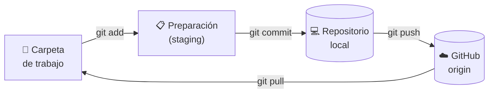
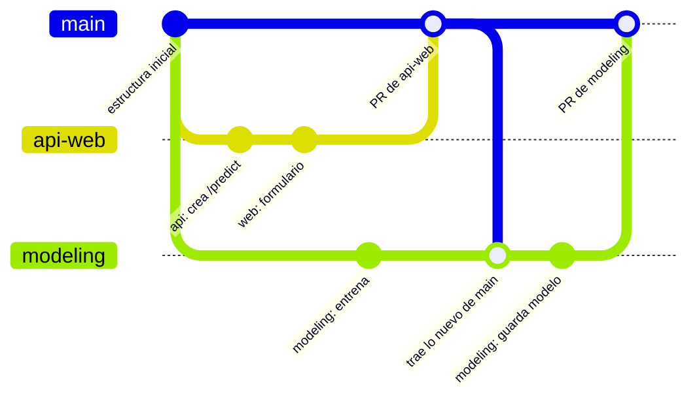

# 🌱 Guía de Git para el proyecto

Qué es Git, para qué lo usamos y los comandos que necesitas para colaborar en **Customer Churn Analysis** sin pisar el trabajo de nadie.

> [!NOTE]
> En el README, en [Cómo colaborar](../README.md#-cómo-colaborar), está el paso a paso con **GitHub Desktop**, con botones. Esta guía explica **qué pasa por dentro** y cómo hacer lo mismo con **comandos en la terminal**. Puedes usar las dos formas, incluso mezclarlas: trabajan sobre la misma carpeta.

---

## 📑 Contenido

- [¿Qué es Git?](#-qué-es-git)
- [¿Para qué nos sirve en este proyecto?](#-para-qué-nos-sirve-en-este-proyecto)
- [Cómo funciona: las 4 zonas](#-cómo-funciona-las-4-zonas)
- [Las ramas del proyecto](#-las-ramas-del-proyecto)
- [Configuración inicial (una sola vez)](#-configuración-inicial-una-sola-vez)
- [Comandos esenciales](#-comandos-esenciales)
- [Tu día a día, paso a paso](#-tu-día-a-día-paso-a-paso)
- [Pull Request: cómo llega tu trabajo a main](#-pull-request-cómo-llega-tu-trabajo-a-main)
- [Conflictos: qué son y qué hacer](#-conflictos-qué-son-y-qué-hacer)
- [Lo que nunca debes hacer](#-lo-que-nunca-debes-hacer)
- [Problemas comunes](#-problemas-comunes)
- [Resumen rápido](#-resumen-rápido)

---

## 🤔 ¿Qué es Git?

**Git es un programa que guarda el historial de cambios de los archivos de un proyecto.**

Cada vez que terminas algo, le pides a Git que tome una "foto" del proyecto. Esa foto se llama **commit**. Con los commits puedes ver qué cambió, quién lo cambió, cuándo y por qué. Y si algo se rompe, puedes volver a una versión anterior.

Sin Git, un trabajo en equipo suele terminar así:

```
analisis.ipynb
analisis_final.ipynb
analisis_final_v2.ipynb
analisis_final_v2_AHORA_SI.ipynb
analisis_final_v2_AHORA_SI (copia de Juan).ipynb
```

Los archivos van y vienen por WhatsApp o por correo, y nadie sabe cuál es el bueno. Con Git hay **un solo archivo** con todo su historial, y **una sola versión oficial** que todos comparten.

### Git, GitHub y GitHub Desktop no son lo mismo

| | Qué es | Dónde está |
|---|---|---|
| **Git** | El programa que guarda el historial | En tu computadora |
| **GitHub** | La página web donde se guarda la copia compartida del proyecto | En internet |
| **GitHub Desktop** | Una aplicación con botones que usa Git por dentro | En tu computadora |

Piensa en Git como el **motor**, en GitHub como el **punto de encuentro** de todo el equipo y en GitHub Desktop como un **volante** fácil de usar. Con la terminal manejas el motor directamente.

---

## 🎯 ¿Para qué nos sirve en este proyecto?

En este repositorio trabajan **5 equipos al mismo tiempo**: Limpieza y EDA, Modelos, API y Web, Dashboard y RPA. Git nos permite:

- **Trabajar en paralelo sin pisarnos.** Cada equipo tiene su propia rama. Lo que hace Modelos en `modeling` no afecta a API y Web en `api-web` hasta que se une a `main`.
- **Saber quién cambió qué y por qué.** Cada commit guarda el autor, la fecha y un mensaje. Por ejemplo, en el historial del proyecto aparece `docs: agrega a Christopher al equipo API y Web`.
- **Revisar antes de aprobar.** Nada entra a `main` sin un Pull Request que revisa Michael. Así `main` siempre tiene una versión que funciona.
- **Volver atrás.** Si un cambio rompe algo, se deshace sin perder el resto del trabajo.
- **Tener una sola versión oficial.** El código, los datos limpios y el modelo están en un solo lugar. Se acabó el "¿me pasas tu última versión?".

---

## 🧠 Cómo funciona: las 4 zonas

Tus cambios pasan por 4 lugares antes de llegar a tus compañeros:



| Zona | Qué hay ahí |
|---|---|
| **Carpeta de trabajo** | Los archivos que ves y editas en VS Code. |
| **Preparación (staging)** | Los cambios que elegiste para el próximo commit. Es como la caja donde metes lo que vas a enviar. |
| **Repositorio local** | Tu historial de commits, guardado en la carpeta oculta `.git`. Por ahora solo lo ves tú. |
| **GitHub (`origin`)** | La copia compartida. Lo que subes con `git push` lo ven todos. Lo que suben los demás lo bajas con `git pull`. |

> [!IMPORTANT]
> Un commit solo está en **tu computadora** hasta que haces `git push`. Mientras no lo subas, tus compañeros no ven tu trabajo, y si a tu computadora le pasa algo, se pierde.

**`origin`** es el nombre que Git le da a GitHub cuando clonas el proyecto. Por eso verás nombres como `origin/main` u `origin/api-web`: son las ramas tal como están en GitHub.

---

## 🌳 Las ramas del proyecto

Una **rama** es una línea de trabajo paralela. `main` tiene la versión aprobada y cada equipo trabaja en la suya:

| Equipo | Rama | Carpeta |
|---|---|---|
| 🧹 Limpieza y 🔍 EDA | `cleaning-eda` | `src/cleaning/` y `notebooks/` |
| 🤖 Modelos de ML | `modeling` | `src/modeling/` |
| 🔌 API y 🌐 Web | `api-web` | `src/api/`, `web/` y `tests/` |
| 📊 Dashboard | `dashboard` | `dashboard/` |
| ⚙️ RPA | `rpa` | `src/rpa/` |

Así se ve el trabajo de dos equipos en el tiempo:



1. Cada equipo hace commits en su rama, sin afectar a los demás.
2. Cuando termina una parte, abre un **Pull Request** para unir su rama a `main`. Michael lo revisa y lo une (*merge*).
3. Los otros equipos traen lo nuevo de `main` a su rama, para trabajar siempre con lo último.

> [!TIP]
> Dentro de un equipo, **todos trabajan en la misma rama**. Por ejemplo, Michael y Christopher comparten `api-web`. Por eso es tan importante bajar los cambios antes de empezar (`git pull`) y subirlos al terminar (`git push`).

---

## 🔧 Configuración inicial (una sola vez)

Necesitas tener Git instalado (está en la [Instalación del README](../README.md#-instalación)). Abre una terminal en VS Code con **Terminal → New Terminal**. En Windows sirven PowerShell o Git Bash.

**1. Comprueba que Git está instalado**

```bash
git --version
```

Debe responder `git version` y un número. Si dice que no reconoce el comando, instala Git desde [git-scm.com](https://git-scm.com/downloads) y reinicia VS Code.

**2. Dile a Git quién eres.** Tu nombre y tu correo aparecen en cada commit.

```bash
git config --global user.name "Tu Nombre"
git config --global user.email "tu-correo@ejemplo.com"
```

> [!TIP]
> Usa el **mismo correo de tu cuenta de GitHub**, así tus commits aparecen con tu foto y tu usuario. Si en GitHub tienes activado que tu correo sea privado, usa el que termina en `@users.noreply.github.com`. Lo encuentras en GitHub, en **Settings → Emails**.

**3. Dos ajustes que evitan sustos**

```bash
# Al hacer pull, unir los cambios con un merge
git config --global pull.rebase false

# Si Git pide escribir un mensaje, que abra VS Code
git config --global core.editor "code --wait"
```

- Sin el primero, `git pull` puede detenerse con el error `Need to specify how to reconcile divergent branches`. Pasa cada vez que tú y un compañero suben cambios a la misma rama.
- Sin el segundo, Git puede abrir **Vim**, un editor de la terminal del que es difícil salir.

> [!NOTE]
> En Mac, si la terminal no reconoce `code`, abre VS Code, pulsa **Cmd + Shift + P** y elige **Shell Command: Install 'code' command in PATH**.

**4. Revisa tu configuración**

```bash
git config --global --list
```

**5. Inicia sesión en GitHub.** Se hace la primera vez que subes cambios con `git push`.

- **Windows:** Git ya trae un asistente. En tu primer `git push` se abre una ventana para iniciar sesión en GitHub desde el navegador.
- **Mac / Linux:** instala [GitHub CLI](https://cli.github.com/) y ejecuta `gh auth login`. Elige **GitHub.com → HTTPS → Login with a web browser** y responde **Yes** cuando pregunte si quieres usarlo con Git.

> [!WARNING]
> Si la terminal te pide una contraseña, **tu contraseña de GitHub no sirve**: GitHub dejó de aceptarla para Git. Usa una de las dos opciones de arriba.

### Clonar el proyecto

Si ya lo clonaste con GitHub Desktop, **sáltate este paso**: abre esa carpeta en VS Code y la terminal ya estará en el lugar correcto.

```bash
git clone https://github.com/HeymichaelRD/customer-churn-analysis.git
cd customer-churn-analysis
```

---

## 🧰 Comandos esenciales

### 👀 Ver qué está pasando

| Comando | Qué hace |
|---|---|
| `git status` | Muestra en qué rama estás y qué archivos cambiaste. **Úsalo antes y después de cada paso.** |
| `git diff` | Muestra línea por línea lo que cambiaste y todavía no preparaste. |
| `git diff --staged` | Lo mismo, pero de lo que ya preparaste con `git add`. |
| `git log --oneline -10` | Muestra los últimos 10 commits, uno por línea. |
| `git log --oneline --graph --all -20` | Lo mismo, pero dibuja las ramas. |
| `git branch -a` | Lista las ramas de tu computadora y las de GitHub (`remotes/origin/...`). |

`git status` es tu mejor amigo. Así se lee lo que responde:

| Si ves… | Significa |
|---|---|
| `On branch api-web` | Estás en la rama `api-web`. |
| `Your branch is up to date with 'origin/api-web'` | Tu rama está igual que en GitHub, según lo último que bajaste. |
| `Your branch is ahead of 'origin/api-web' by 2 commits` | Tienes 2 commits sin subir: falta `git push`. |
| `Your branch is behind 'origin/api-web' by 3 commits` | Hay 3 commits en GitHub que no tienes: haz `git pull`. |
| `Changes not staged for commit` | Archivos que cambiaste, pero sin `git add`. |
| `Untracked files` | Archivos nuevos que Git todavía no sigue. |
| `Changes to be committed` | Lo que entrará en tu próximo commit. |
| `nothing to commit, working tree clean` | No tienes cambios pendientes. Todo está guardado. |

### 🌿 Cambiar de rama

| Comando | Qué hace |
|---|---|
| `git switch api-web` | Te lleva a la rama `api-web`. Si solo existe en GitHub, la crea en tu computadora conectada con la de GitHub. |
| `git switch main` | Te lleva a `main`, para mirar. **En `main` no se trabaja.** |

En tutoriales viejos verás `git checkout api-web`. Hace lo mismo.

### 📥 Bajar cambios

| Comando | Qué hace |
|---|---|
| `git fetch` | Pregunta a GitHub qué hay de nuevo **sin tocar tus archivos**. Después, `git status` te dice si estás atrasado. |
| `git pull` | Baja los cambios que tus compañeros subieron a **tu rama** y los une con los tuyos. |
| `git pull origin main` | Baja lo nuevo de **`main`** y lo une a tu rama. Así tienes lo último que se aprobó de los otros equipos. |

> [!TIP]
> Haz `git pull` con tus cambios **ya guardados en un commit** (`git status` dice `working tree clean`). Si aparece un conflicto, podrás deshacer el pull sin perder nada.

### 💾 Guardar cambios (commit)

| Comando | Qué hace |
|---|---|
| `git add archivo` | Prepara un archivo para el próximo commit. |
| `git add carpeta/` | Prepara todos los cambios de una carpeta. |
| `git restore --staged archivo` | Saca un archivo de la preparación. Tus cambios siguen en el archivo. |
| `git commit -m "mensaje"` | Guarda la foto con un mensaje. |

Por ejemplo, alguien del equipo de Limpieza:

```bash
git add src/cleaning/clean_data.py
git add notebooks/01_cleaning_juan.ipynb
git commit -m "cleaning: elimina clientes duplicados"
```

> [!WARNING]
> Cuidado con `git add .`, que prepara **todo** lo que cambió. Es la forma más fácil de subir por error el notebook de otra persona, archivos de prueba o datos que no te tocan. Revisa antes con `git status` y agrega solo tus archivos o la carpeta de tu equipo.

**Mensajes de commit:** en español, en presente y empezando con el área, como dice el README.

| ❌ Evita | ✅ Mejor |
|---|---|
| `cambios` | `eda: agrega gráfico de churn por tipo de contrato` |
| `arreglado` | `api: valida que tenure no sea negativo` |
| `final final` | `modeling: guarda el pipeline con joblib` |

### 📤 Subir cambios

| Comando | Qué hace |
|---|---|
| `git push` | Sube tus commits a tu rama en GitHub. |

Si alguien de tu equipo subió algo antes que tú, Git rechaza tu push:

```
 ! [rejected]        api-web -> api-web (fetch first)
error: failed to push some refs to '...'
hint: Updates were rejected because the remote contains
hint: work that you do not have locally.
```

No es un error tuyo. Primero baja lo de tu compañero y después sube lo tuyo:

```bash
git pull
git push
```

### ⏪ Deshacer

| Quiero… | Comando | Ojo |
|---|---|---|
| Descartar lo que cambié en un archivo, sin commit | `git restore archivo` | Esos cambios **se pierden para siempre** |
| Sacar un archivo que preparé con `git add` | `git restore --staged archivo` | Tus cambios siguen en el archivo |
| Guardar mis cambios a un lado un momento | `git stash` | Los recuperas con `git stash pop` |
| Deshacer un commit que ya subí | `git revert a820a91` | Crea un commit nuevo que lo revierte. No borra el historial |

`a820a91` es un ejemplo: cada commit tiene un código de 7 letras y números, y lo ves con `git log --oneline`.

### 🖱️ Lo mismo en GitHub Desktop

| En GitHub Desktop | En la terminal |
|---|---|
| **Current branch** → elegir la rama | `git switch <rama>` |
| **Fetch origin** | `git fetch` |
| **Pull origin** | `git pull` |
| **Branch → Update from main** | `git pull origin main` |
| Marcar o desmarcar archivos en **Changes** | `git add` / `git restore --staged` |
| **Commit to `<rama>`** | `git commit -m "..."` |
| **Push origin** | `git push` |
| Pestaña **History** | `git log` |
| Clic derecho en un archivo → **Discard changes** | `git restore <archivo>` |
| Clic derecho en un commit → **Revert changes in commit** | `git revert <código>` |

---

## 🔁 Tu día a día, paso a paso

Este es el ciclo completo. El ejemplo es del equipo API y Web: cambia la rama y los archivos por los tuyos.

```bash
# 1. Al empezar: ve a tu rama y trae lo último
git switch api-web
git pull                # lo que subió tu equipo
git pull origin main    # lo aprobado de otros equipos

# 2. Trabaja en VS Code, solo en TUS archivos

# 3. Revisa qué cambiaste
git status
git diff

# 4. Guarda (repite 2, 3 y 4 cada vez que
#    termines algo pequeño)
git add web/predict.html web/js/predict.js
git commit -m "web: agrega el formulario de predicción"

# 5. Al terminar: trae lo nuevo y sube lo tuyo
git pull
git push
```

**Para cada equipo:**

| Equipo | Paso 1 | Ejemplo de commit |
|---|---|---|
| 🧹 Limpieza y 🔍 EDA | `git switch cleaning-eda` | `eda: agrega gráfico de churn por tipo de contrato` |
| 🤖 Modelos de ML | `git switch modeling` | `modeling: entrena una regresión logística` |
| 🔌 API y 🌐 Web | `git switch api-web` | `api: crea endpoint /predict` |
| 📊 Dashboard | `git switch dashboard` | `dashboard: agrega la página de churn por contrato` |
| ⚙️ RPA | `git switch rpa` | `rpa: crea la estructura del bot` |

> [!TIP]
> - Haz **commits pequeños y seguido**: uno por cada cosa que termines. Es más fácil revisarlos y, si algo falla, deshacerlos.
> - Haz **`git push` al menos al final de cada día** de trabajo.
> - Si agregaste una librería a `requirements.txt`, avisa en el grupo: tus compañeros tienen que correr `pip install -r requirements.txt` después de su `git pull`.

---

## 🔀 Pull Request: cómo llega tu trabajo a main

Un **Pull Request** (PR) es una solicitud para unir tu rama a `main`. No es un comando de Git: se hace en la página de GitHub.

1. Sube tus cambios con `git push`.
2. Abre [el repo en GitHub](https://github.com/HeymichaelRD/customer-churn-analysis). Arriba aparece un aviso con el botón **Compare & pull request**. Si no aparece, ve a **Pull requests → New pull request**.
3. Revisa que diga **base: `main`** ← **compare: `tu-rama`**.
4. Escribe un título claro y explica qué hiciste. Si agregaste librerías a `requirements.txt`, menciónalo.
5. Haz clic en **Create pull request**. GitHub le pide la revisión a Michael automáticamente (lo indica el archivo `.github/CODEOWNERS`).
6. Si Michael pide cambios, hazlos en tu rama, haz commit y `git push`. **El Pull Request se actualiza solo**: no hay que crear otro.
7. Cuando Michael lo aprueba y hace el merge, tu trabajo queda en `main`. Tu rama sigue existiendo: continúa trabajando en ella.

> [!NOTE]
> `main` está protegida: los cambios solo entran por un Pull Request aprobado. Si intentas hacer `git push` directo a `main`, GitHub lo rechaza.

---

## 💥 Conflictos: qué son y qué hacer

Un **conflicto** ocurre cuando dos personas cambiaron **las mismas líneas del mismo archivo** y Git no sabe cuál dejar. Aparece al hacer `git pull` o `git pull origin main`:

```
Auto-merging web/predict.html
CONFLICT (content): Merge conflict in web/predict.html
Automatic merge failed; fix conflicts and then commit
the result.
```

Git marca la parte en conflicto dentro del archivo:

```
<h1>Predecir</h1>
<<<<<<< HEAD
<p>Ingresa los datos del cliente</p>
=======
<form id="customer-form"></form>
>>>>>>> 8594554b96da9c08135646cfd11e157a78b8e4f6
```

- Entre `<<<<<<< HEAD` y `=======` está **tu versión**.
- Entre `=======` y `>>>>>>>` está **la versión que llegó** de GitHub.

### Cómo resolverlo

Hazlo solo si el archivo es tuyo y entiendes los dos cambios:

1. Abre el archivo en VS Code. Encima del conflicto aparecen las opciones **Accept Current Change** (la tuya), **Accept Incoming Change** (la que llegó) y **Accept Both Changes** (las dos). También puedes editarlo a mano.
2. Comprueba que no quede ninguna marca `<<<<<<<`, `=======` ni `>>>>>>>`, y guarda.
3. Termina el merge y sube:

```bash
git add web/predict.html
git commit --no-edit
git push
```

### Si no sabes qué hacer

No borres nada ni fuerces nada. Deshaz el pull y avísale a Michael:

```bash
git merge --abort
```

Tu carpeta vuelve a quedar como antes del `git pull`. Por eso conviene hacer commit antes de cada pull: si no, `git merge --abort` puede fallar.

### Cómo evitarlos

- **Cada persona trabaja en sus archivos.** El [plan de API y Web](plan-api-web.md#-quién-hace-qué) dice quién es responsable de cada uno.
- **Cada persona tiene sus propios notebooks** (`01_cleaning_juan.ipynb`). Un `.ipynb` es un archivo enorme con código, resultados e imágenes: un conflicto ahí es casi imposible de resolver a mano.
- **Los archivos binarios** (`.pbix`, `.pkl`, `.joblib`, `.xlsx`, imágenes) no se pueden combinar: si dos personas los cambian, se pierde una de las versiones. Por eso solo los sube el responsable.
- **Haz `git pull` seguido** y commits pequeños. Cuanto más tiempo pasas sin bajar cambios, más difícil es el conflicto.

---

## 🚫 Lo que nunca debes hacer

| ❌ No hagas esto | Por qué |
|---|---|
| `git push --force` (o `-f`) | Reemplaza la rama de GitHub con la tuya y **borra lo que subieron tus compañeros**. |
| `git reset --hard` | Borra tus cambios sin guardar, sin forma de recuperarlos. |
| Trabajar en `main` | `main` es la versión aprobada. Se trabaja siempre en la rama del equipo. |
| `git add .` sin revisar `git status` | Subes archivos que no son tuyos o que no deberían subirse. |
| Subir `.env` o contraseñas | Aunque se borren después, **quedan en el historial**. `.gitignore` ya evita que se suba el `.env`: no lo saltes con `git add -f`. |
| Subir archivos de más de 100 MB | GitHub los rechaza. Para pruebas usa la carpeta `tmp/`, que Git ignora. |
| Editar el notebook o los archivos de otra persona | Es la causa número uno de conflictos. |
| Borrar la carpeta y clonar de nuevo "para arreglar" | Pierdes los commits que no habías subido. Mejor pregunta. |
| Copiar comandos de internet que no entiendes | Sobre todo los que tienen `--force`, `reset` o `rebase`. Pregunta primero en el grupo. |

---

## 🧯 Problemas comunes

<details>
<summary><b><code>! [rejected] ... (fetch first)</code> al hacer push</b></summary>

Alguien de tu equipo subió cambios antes que tú. Baja los suyos y sube los tuyos:

```bash
git pull
git push
```

</details>

<details>
<summary><b><code>Need to specify how to reconcile divergent branches</code> al hacer pull</b></summary>

Falta un ajuste de la configuración inicial. Ejecútalo una vez y repite el pull:

```bash
git config --global pull.rebase false
git pull
```

</details>

<details>
<summary><b><code>Your local changes ... would be overwritten</code> al cambiar de rama o hacer pull</b></summary>

Tienes cambios sin guardar que chocan con los que vienen. Haz commit, o guárdalos a un lado un momento:

```bash
git stash               # guarda tus cambios a un lado
git switch modeling     # o git pull
git stash pop           # te los devuelve
```

</details>

<details>
<summary><b>Se abrió una pantalla rara en la terminal y no puedo salir</b></summary>

Es **Vim**, un editor de la terminal. Para guardar y salir pulsa **Esc**, escribe `:wq` y pulsa **Enter**. Para que no vuelva a pasar, configura VS Code como editor:

```bash
git config --global core.editor "code --wait"
```

Si se abre una pestaña en VS Code (`COMMIT_EDITMSG` o `MERGE_MSG`), revisa el mensaje, guarda y cierra la pestaña.

</details>

<details>
<summary><b><code>fatal: not a git repository</code></b></summary>

La terminal no está en la carpeta del proyecto. En VS Code, ve a **File → Open Folder** y abre `customer-churn-analysis`. Luego abre una terminal nueva.

</details>

<details>
<summary><b><code>pathspec '...' did not match</code> al cambiar de rama</b></summary>

Revisa que el nombre de la rama esté bien escrito. Si es una rama nueva en GitHub, primero actualiza la lista:

```bash
git fetch
git switch cleaning-eda
```

</details>

<details>
<summary><b><code>Permission denied</code> o <code>403</code> al hacer push</b></summary>

No iniciaste sesión en GitHub o tu cuenta todavía no es colaboradora del repo. Revisa el paso 5 de la [configuración inicial](#-configuración-inicial-una-sola-vez) y, si sigue igual, pídele a Michael que te agregue.

</details>

<details>
<summary><b><code>GH013: Repository rule violations</code> al hacer push</b></summary>

Estás intentando subir directo a `main`, y `main` está protegida. Mira el caso siguiente para pasar tus commits a la rama de tu equipo.

</details>

<details>
<summary><b>Trabajé en <code>main</code> sin darme cuenta</b></summary>

**Si todavía no hiciste commit,** cambia a tu rama y tus cambios se van contigo:

```bash
git switch api-web
```

Si Git no te deja, usa `git stash`, luego `git switch api-web` y luego `git stash pop`.

**Si ya hiciste commit en `main`,** pasa esos commits a tu rama y súbelos desde ahí:

```bash
git switch api-web
git merge main
git push
```

Tu `main` local se queda con esos commits de más. No pasa nada: no trabajes en ella. Cuando Michael una tu Pull Request, `git pull` en `main` la deja igual que en GitHub.

</details>

<details>
<summary><b>Subí un archivo por error</b></summary>

Avísale a Michael. Si fue una contraseña, **cámbiala de inmediato**: aunque se borre el archivo, queda en el historial.

</details>

---

## 📋 Resumen rápido

**Los 7 comandos que más vas a usar:**

```bash
git status                  # ¿dónde estoy y qué cambié?
git switch <tu-rama>        # ir a la rama de tu equipo
git pull                    # bajar lo de tu equipo
git pull origin main        # traer lo aprobado en main
git add <archivos>          # preparar tus cambios
git commit -m "área: qué hiciste"
git push                    # subir a GitHub
```

**Antes de cada `git push`:**

- [ ] `git status` dice que estoy en la rama de mi equipo.
- [ ] Solo agregué archivos de mi carpeta: nada de `.env`, `tmp/` ni notebooks ajenos.
- [ ] El mensaje sigue el formato `área: qué hice`.
- [ ] Hice `git pull` justo antes.
- [ ] Si cambié la API, `pytest` pasa todas las pruebas.

### 🏁 Tu primera práctica

Agrega tu nombre a la tabla de [Integrantes del README](../README.md#-integrantes) siguiendo esta guía: cambia a la rama de tu equipo, edita, haz commit, push y abre tu primer Pull Request.

### 📚 Para aprender más

- [Pro Git en español](https://git-scm.com/book/es/v2): el libro oficial de Git, gratis.
- [Learn Git Branching](https://learngitbranching.js.org/?locale=es_ES): un juego para practicar ramas en el navegador.
