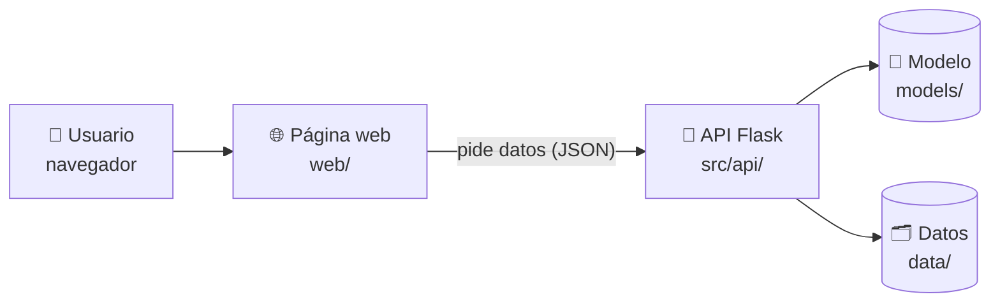

# 🔌🌐 Plan del equipo API y Web

Qué vamos a construir, en qué orden y quién hace cada parte. Si algo cambia, se actualiza en este archivo con un Pull Request.

---

## 🎯 Objetivo

Vamos a construir dos cosas:

- Una **API en Flask** que recibe los datos de un cliente y devuelve la probabilidad de que se dé de baja.
- Una **página web** que usa esa API.

La web no se queda en "formulario → número". Convierte cada predicción en **decisiones**: cuánto dinero está en riesgo y qué hacer para retener al cliente. Los datos del proyecto muestran por qué importa:

- Se dio de baja el **26.5%** de los clientes. Eso son **US$139,131 al mes** de los US$456,117 que ingresa la empresa (30.5%).
- Con contrato **mes a mes** se va el **42.7%** de los clientes. Con contrato de **dos años**, solo el **2.8%**.
- Entre los clientes con contrato mes a mes, fibra óptica y 12 meses o menos en la empresa, se va el **70.2%**.

> [!NOTE]
> Estas cifras salen del dataset original. Las oficiales las confirma el equipo de Limpieza y EDA.

**Plazo:** de 2 a 4 semanas desde el 7 de noviembre de 2026. Primero hacemos que todo funcione en nuestras computadoras. Publicar la web en internet es opcional, al final.

---

## 🧭 Cómo se conecta todo



- La web nunca lee el modelo ni los datos directamente: todo pasa por la API.
- Mientras no llegue el modelo real del equipo de Modelos, la API usa un **modelo de prueba** y la web muestra el aviso **"Modo demostración"**. Así nadie se queda esperando.

---

## 🖥️ Las páginas de la web

| Página | Archivo | Qué hace | Fase |
|---|---|---|---|
| Inicio | `index.html` | Muestra el problema en números, explica cómo funciona en 3 pasos y lleva a las demás páginas | 2 |
| Predecir | `predict.html` | Tiene el formulario del cliente y muestra el resultado: probabilidad, nivel de riesgo e ingreso en riesgo. Incluye clientes de ejemplo, recomendaciones y un simulador | 1 y 2 |
| Por lotes | `batch.html` | Recibe un CSV con muchos clientes. Muestra un resumen y una tabla ordenada por riesgo, y permite descargar los resultados | 3 |
| Hallazgos | `insights.html` | Muestra las cifras clave y gráficos interactivos del EDA | 2 |
| Sobre el proyecto | `about.html` | Explica cómo se hizo, quiénes participaron, qué modelo usa y sus límites | 2 y 3 |

### ✨ Lo que la hace destacar

- **Ingreso en riesgo.** Es el cargo mensual multiplicado por la probabilidad de baja, al mes y al año. Traduce el modelo a dinero.
- **Recomendaciones de retención.** La API prueba acciones como ofrecer un contrato de un año, pasar el pago a automático o activar el soporte técnico. Luego muestra las 3 que más bajan el riesgo, por ejemplo: "Ofrecer un contrato de un año: de 78% a 46%". Se acompaña de un **simulador**: cambias un dato del cliente y ves cómo cambia su riesgo.
- **Clientes de ejemplo.** Unos botones cargan clientes reales del dataset: de alto riesgo, medio, leal o uno al azar. La web muestra si el modelo **acertó**, comparando con lo que pasó de verdad.
- **Hallazgos.** Gráficos interactivos hechos con HTML y CSS, sin librerías, y un selector para cambiar el criterio: contrato, antigüedad, internet, forma de pago… Cada gráfico lleva su hallazgo explicado en una frase.
- **Por lotes.** Responde a la pregunta "¿a quién hay que llamar esta semana?", incluso con el dataset completo de 7,043 clientes.

### 🎨 Diseño

El diseño sale del prototipo que preparó Michael: estilo Apple, con modo claro y modo oscuro. En el celular, el menú pasa a una barra con íconos abajo de la pantalla.

- Las 5 páginas ya tienen el encabezado, el pie, los textos fijos y su propia hoja de estilos (`css/<página>.css`), sacada del prototipo.
- Lo que falta en cada página está marcado con un **recuadro punteado**, que indica la fase y la ruta de la API que usa. En cada fase, Michael lo reemplaza por el contenido real, siguiendo el prototipo.
- Los componentes del prototipo ya están listos en `web/js/ui.js`: el anillo de probabilidad, la etiqueta de riesgo, el control segmentado, el mensaje flotante y el globo de ayuda de los gráficos.

---

## 🔌 La API

| Ruta | Qué hace | Fase |
|---|---|---|
| `GET /health` | Dice si la API está encendida y qué modelo usa | ✅ 0 |
| `POST /predict` | Devuelve la probabilidad de baja, el nivel de riesgo (`low`, `medium` o `high`) y la versión del modelo | ✅ 1 |
| `GET /samples` y `GET /samples/random` | Devuelven clientes reales de ejemplo, con lo que pasó de verdad (`actual_churn`) | 2 |
| `POST /recommendations` | Devuelve las acciones que más bajan el riesgo de un cliente | 2 |
| `GET /insights` | Devuelve las cifras y los segmentos para la página de Hallazgos | 2 |
| `GET /model-info` | Devuelve el algoritmo, la fecha de entrenamiento y las métricas del modelo | 3 |
| `POST /predict/batch` | Predice todos los clientes de un CSV (hasta 5 MB) | 3 |

Los detalles de `/health` y `/predict` (campos, respuestas y errores) están en el README, en [Contratos entre equipos](../README.md#-contratos-entre-equipos). Las demás rutas se documentan ahí cuando se construyan. Cómo funciona `/predict` por dentro está explicado en [api-fase1.md](api-fase1.md).

**Archivos de la API** (en `src/api/`):

| Archivo | Para qué sirve |
|---|---|
| `app.py` | Define las rutas. Solo recibe la petición, llama al archivo que hace el trabajo y responde. Ya existe, con `/health` y `/predict` |
| `schema.py` | Revisa que lleguen bien los 19 campos del cliente. También aplica las reglas de coherencia: si no tiene teléfono, no puede tener líneas múltiples; si no tiene internet, no puede tener servicios de internet; y debe tener al menos teléfono o internet |
| `model_service.py` | Carga el modelo indicado en `MODEL_PATH` (archivo `.env`). Si no existe, usa el modelo de prueba. También define los niveles de riesgo |
| `recommendations.py` | Guarda la lista de acciones de retención y calcula cuáles ayudan más |
| `data_service.py` | Calcula las cifras de Hallazgos y elige los clientes de ejemplo. Lee `data/processed/`, o `data/raw/` mientras no exista |
| `batch.py` | Lee el CSV, revisa cada fila y resume los resultados. Las filas con error se informan, pero no detienen el resto |

Las pruebas van en `tests/` y se ejecutan con `pytest`.

> [!NOTE]
> **Niveles de riesgo provisionales:** bajo si la probabilidad es menor que 30%, medio de 30% a 59% y alto desde 60%. Los ajustamos con el equipo de Modelos.

---

## 📅 Fases

Cada fase termina con un **Pull Request de `api-web` a `main`**, que revisa Michael.

| Fase | Qué incluye | Cuándo | Estado |
|---|---|---|---|
| **0. Preparación** | La base de la API (`/health`) y de las 5 páginas, los archivos compartidos y el contrato v1 | Días 1 y 2 | ✅ Hecha |
| **1. Primera versión completa** | `schema.py`, `POST /predict` con el modelo de prueba y sus pruebas. `predict.html` con el formulario, el resultado, el ingreso en riesgo y los errores | Semana 1 | ✅ La API (PR #5) y `predict.html`, con el nuevo diseño |
| **2. Lo que la hace destacar** | Clientes de ejemplo, recomendaciones y simulador, Hallazgos, Inicio y Sobre el proyecto | Semana 2 | ⏳ |
| **3. Modelo real y lotes** | El modelo del equipo de Modelos, `/model-info`, `POST /predict/batch` y `batch.html` | Semana 3 | ⏳ |
| **4. Pulido y demo** | Revisar la vista en celular, la accesibilidad y los textos. Completar el README y preparar el guion de la demo. Publicar en internet es opcional | Semana 4 | ⏳ |

**Guion de la demo (3 minutos):** Inicio → un cliente de alto riesgo → su recomendación → el simulador → Hallazgos → predicción por lotes con el dataset completo → Sobre el proyecto.

---

## 👥 Quién hace qué

Cada persona trabaja **solo en sus archivos**. Así dos personas no cambian el mismo archivo y no hay conflictos.

| Persona | Responsable de | Archivos |
|---|---|---|
| Michael (mantenedor del repo) | Toda la página web (las 5 páginas y los archivos compartidos), contratos con los otros equipos, conectar el modelo real, predicción por lotes, README y revisión de los Pull Requests | `web/` y `src/api/batch.py` |
| Christopher ([chpujols-DS07](https://github.com/chpujols-DS07)) | La API y sus pruebas | `src/api/` (menos `batch.py`) y `tests/` |

> [!IMPORTANT]
> - Si necesitas un cambio en la web o en `src/api/batch.py`, pídeselo a Michael. Si es en el resto de la API o en las pruebas, a Christopher.
> - El **encabezado y el pie** son iguales en las 5 páginas: si cambia uno, se cambia en todas a la vez.

---

## 🛠️ Cómo trabajar

### Cada día, en GitHub Desktop

Todo el equipo trabaja en la misma rama, `api-web`. Por eso es tan importante bajar los cambios antes de empezar y subirlos al terminar.

1. Con la rama **`api-web`** elegida, haz clic en **Fetch origin** y luego en **Pull origin**.
2. En el menú **Branch → Update from main**, trae lo último que aprobaron los otros equipos.
3. Trabaja en tus archivos y haz **commits pequeños**, por ejemplo `web: agrega el formulario de predicción` o `api: valida el campo tenure`.
4. Al terminar, haz clic en **Push origin** para que el resto vea tus cambios.

En el README, en [Cómo colaborar](../README.md#-cómo-colaborar), está el paso a paso completo con GitHub Desktop.

### Ver la web en tu computadora

Abre dos terminales, las dos con el ambiente virtual (`.venv`) activo:

```bash
flask --app src/api/app run                  # terminal 1: la API
python -m http.server 8000 --directory web   # terminal 2: la página web
```

Abre `http://localhost:8000` en el navegador. Arriba a la derecha, un punto verde indica que la página está conectada con la API.

### Reglas para el código

- **Usa los archivos compartidos** en lugar de repetir código:
  - [`web/js/api.js`](../web/js/api.js) se encarga de todas las llamadas a la API. No uses `fetch` directamente: `api.js` ya maneja los errores y los tiempos de espera.
  - [`web/js/labels.js`](../web/js/labels.js) traduce los campos y valores al español (`"Month-to-month"` → "Mes a mes") y da formato a las cifras con `formatPercent` y `formatMoney`.
  - [`web/css/base.css`](../web/css/base.css) define las variables de colores, letras y sombras, en modo claro y en modo oscuro. Escribe `color: var(--fg-2)`, nunca un color a mano como `#6e6e73`. Así tu página se ve bien sola en los dos modos.
  - [`web/js/ui.js`](../web/js/ui.js) tiene los componentes del diseño. Por ejemplo, `mountRing` dibuja el anillo de probabilidad y `setBadge` pone la etiqueta "Riesgo alto". Al principio del archivo está explicado cómo usar cada uno.
- El código va en inglés (variables, funciones y archivos). Los comentarios y los textos de la página van en español.
- Los nombres de archivo van sin tildes, sin ñ y sin espacios.
- Cada página ya enlaza su hoja de estilos, por ejemplo `css/predict.css`, con los estilos del prototipo. Su código, por ejemplo `js/predict.js`, se crea y se enlaza donde indica el comentario del `<head>`.

### Antes del Pull Request de una fase

- [ ] `pytest` pasa todas las pruebas.
- [ ] La página funciona con la API encendida. Con la API apagada, muestra un aviso claro y no se rompe.
- [ ] Se ve bien en celular. En el navegador, pulsa **F12** y luego **Ctrl + Shift + M**.
- [ ] La consola del navegador (pulsa **F12** y abre la pestaña **Console**) no muestra errores en rojo.

---

## 📜 Lo que necesitamos de los otros equipos

Mientras tanto la API usa el modelo de prueba, así que nadie se queda bloqueado.

| Equipo | Qué necesitamos | Para la fase | Estado |
|---|---|---|---|
| 🤖 Modelos | Los detalles están en la lista de abajo | 3 | ⏳ Pendiente |
| 🧹🔍 Limpieza y EDA | El nombre del archivo limpio en `data/processed/`. Saber qué hacen con los 11 `TotalCharges` vacíos (proponemos tratarlos como 0). Sus 4 o 5 hallazgos principales, en una frase cada uno | 2 | ⏳ Pendiente |
| 📊 Dashboard | Una paleta de colores común, para que la web y Power BI se vean como un solo proyecto. Proponemos la de la web: azul `#0071e3` y, para el riesgo, verde `#34c759`, naranja `#ff9500` y rojo `#ff3b30` | 2 | ⏳ Pendiente |
| ⚙️ RPA (idea opcional) | Su bot podría usar `POST /predict/batch`, por ejemplo para generar cada semana la lista de clientes en riesgo | — | 💡 Propuesta |

**Lo que necesitamos del equipo de Modelos:**

- El modelo final guardado con `joblib` como un **Pipeline de scikit-learn**, es decir, el preprocesamiento y el modelo juntos.
- Que tenga `predict_proba` y acepte las columnas originales del dataset.
- Que esté entrenado con **scikit-learn 1.9.1**, la versión del `requirements.txt`.
- El archivo `models/model_info.json`, con el algoritmo, la fecha, las columnas, el umbral y las métricas.
- Si se puede, los `customerID` del conjunto de prueba.

---

## ❓ Pendiente de decidir

- Los niveles de riesgo definitivos, junto con el equipo de Modelos.
- Si al final publicamos la web en internet (es opcional).
