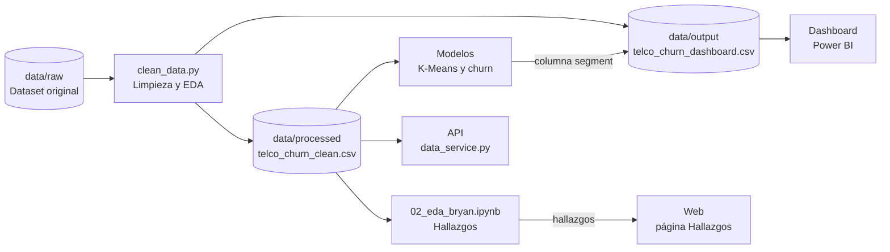

# Equipo Limpieza y EDA: avance, criterios y pendientes

Qué entregó el equipo de Limpieza y EDA, qué criterio se usó en cada decisión, qué queda pendiente y cómo se conecta con el resto del proyecto. Si algo cambia, se actualiza en este archivo con un Pull Request.

**Autor de este documento:** Bryan Abreu ([BryanAbreuu](https://github.com/BryanAbreuu)) · 22 de noviembre de 2026

**Integrantes del equipo:** Bryan Abreu, Jhonfrer Villar y Leonis Matos

---

## Qué entregamos y dónde está

Son **3 archivos** escritos por nosotros. Los otros 2 son CSV que genera el script y que los demás equipos usan directamente.

| Parte | Archivo | Para qué sirve |
|---|---|---|
| **1. EDA** | `notebooks/02_eda_bryan.ipynb` | El análisis: verificación de la data, gráficos, hallazgos y las notas de criterio |
| **2. Limpieza** | `src/cleaning/clean_data.py` | Limpia la data y genera los 2 CSV de abajo |
| **3. Este documento** | `docs/plan-cleaning-eda.md` | Dónde estamos, qué criterios usamos y qué sigue |
| Generado por la limpieza | `data/processed/telco_churn_clean.csv` | Datos limpios para Modelos y la API |
| Generado por la limpieza | `data/output/telco_churn_dashboard.csv` | Datos para Power BI. Falta la columna `segment`, que agrega el equipo de Modelos |

También se actualizó el `README.md`: integrantes del equipo, nombres de los CSV en la tabla de contratos y un enlace a este documento.

Lo que pidió el equipo API y Web ya está resuelto: el nombre del CSV limpio (arriba), qué hacer con los `TotalCharges` vacíos (se llenan con 0) y los 5 hallazgos (más abajo).

---

## Lo que hizo Bryan Abreu

| Fecha | Qué hice | Archivo |
|---|---|---|
| 10 de noviembre de 2026 | Leí el repo y el plan del equipo API y Web para saber qué esperaban de nosotros. Armé el notebook del EDA: carga, calidad de datos, variable objetivo, análisis por variable, segmentos de alto riesgo, impacto en ingresos y conclusiones | `notebooks/02_eda_bryan.ipynb` |
| 19 de noviembre de 2026 | Agregué al notebook la verificación de la data (que es la oficial y cumple el contrato de la API) y la comprobación de las cifras contra las del equipo Web. Agregué las notas de criterio para que el equipo las revise | `notebooks/02_eda_bryan.ipynb` |
| 22 de noviembre de 2026 | Creé el script de limpieza, que genera el CSV limpio y los datos para el dashboard. El notebook comprueba que su limpieza es idéntica a la del script | `src/cleaning/clean_data.py` |
| 22 de noviembre de 2026 | Actualicé el README (integrantes y tabla de contratos) y escribí este documento | `README.md`, `docs/plan-cleaning-eda.md` |

---

## Cómo se ejecuta

Desde la raíz del repo, con el ambiente virtual (`.venv`) activo:

```bash
python src/cleaning/clean_data.py
```

Después se puede abrir `notebooks/02_eda_bryan.ipynb` y correrlo completo.

El script muestra cada paso en la terminal:

- **Paso 1.** Carga el dataset original de `data/raw/`, sin modificarlo.
- **Paso 2.** Verifica que es la data oficial: el archivo, 7,043 filas, 21 columnas, los valores permitidos y las reglas de coherencia del contrato de la API. Si algo no cuadra, se detiene con un error.
- **Paso 3.** Convierte `TotalCharges` a número y llena con 0 los 11 vacíos. Todos son clientes con `tenure` 0.
- **Paso 4.** Verifica el resultado: mismas filas y columnas, sin nulos y el resto de columnas sin cambios.
- **Paso 5.** Guarda `data/processed/telco_churn_clean.csv`.
- **Paso 6.** Guarda `data/output/telco_churn_dashboard.csv`: el archivo limpio más `churn_flag` (1 si el cliente se fue, 0 si se quedó) y `tenure_group` (antigüedad en rangos de 12 meses). Comprueba que la tasa de churn sea 26.5%, igual que el EDA.

---

## Cómo sabemos que está bien

- **La data es la oficial.** El script y el notebook comprueban que el archivo, las columnas, los valores y las reglas coinciden con el README y con el contrato de la API.
- **La limpieza no rompe nada.** El script comprueba que solo cambió `TotalCharges`, y el notebook comprueba que su resultado es idéntico al CSV del script.
- **Las cifras cuadran con las del equipo Web.** El notebook calcula 26.5% de churn, US$139,131 al mes perdidos de US$456,117, 42.7% en mes a mes, 2.8% en dos años y 70.2% en el segmento de alto riesgo. Son exactamente las cifras preliminares de `docs/plan-api-web.md`.
- **El resto del proyecto sigue funcionando.** Las 33 pruebas (`pytest`) pasan.

---

## Hallazgos principales

Una frase cada uno, para la página de Hallazgos y el dashboard:

1. **El 26.5% de los clientes se fue**, y se llevó US$139,131 al mes, el 30.5% del ingreso mensual (aproximadamente US$1.67 millones al año).
2. **El contrato es el factor más fuerte:** con contrato mes a mes se va el 42.7% de los clientes, con contrato de un año el 11.3% y con contrato de dos años solo el 2.8%.
3. **El riesgo se concentra en el primer año:** se va el 47.4% de los clientes con 12 meses o menos, contra el 9.5% de los que llevan más de 4 años.
4. **La fibra óptica y el pago con cheque electrónico se relacionan con más bajas:** con fibra se va el 41.9% (con DSL, el 19.0%) y con cheque electrónico el 45.3% (con pagos automáticos, alrededor del 16%).
5. **Los servicios de soporte se relacionan con menos bajas:** entre los clientes con internet, sin seguridad en línea se va el 41.8% y con ella el 14.6%. Con soporte técnico, 41.6% sin él y 15.2% con él.

**Segmento de mayor riesgo:** mes a mes + fibra óptica + 12 meses o menos. Son 916 clientes (13% del total) y se va el 70.2%.

---

## Criterios de cada decisión (Bryan Abreu)

| Decisión | Criterio |
|---|---|
| Los 11 `TotalCharges` vacíos se llenan con **0** y no se borran | Son clientes reales que acaban de entrar (`tenure` 0), no errores. La API va a recibir clientes nuevos con ese mismo caso y el contrato ya dice que se envía `TotalCharges = 0`, así que el modelo debe aprender con él. Es la misma propuesta del equipo API y Web |
| La limpieza **solo toca `TotalCharges`** | El contrato de la API y el Pipeline del equipo de Modelos esperan las columnas originales. Si cambiamos nombres o valores (por ejemplo, `SeniorCitizen` a texto), los otros equipos tendrían que adaptar su código |
| **No se borran** columnas que casi no influyen (`gender`, `PhoneService`, `MultipleLines`) | Qué variables usa el modelo lo decide el equipo de Modelos con sus métricas, no la limpieza. Además, la API recibe los 19 campos. En el notebook está el ranking como sugerencia |
| "No internet service" y "No phone service" **se quedan como están** | No significan lo mismo que "No": "No" es que tiene el servicio base pero no contrató el extra, y "No internet service" es que no tiene internet. El contrato de la API los usa tal cual |
| La verificación va **al inicio** del script y del notebook | Es la forma de demostrar que trabajamos con la data oficial. Si alguien cambia el archivo por error, falla al principio y no al final |
| Antigüedad en **rangos de 12 meses** | Coincide con la duración de los contratos (mes a mes, un año, dos años) y es fácil de explicar. La web y el dashboard deben usar los mismos rangos para que sus cifras coincidan |
| Los servicios de soporte se comparan **solo entre clientes con internet** | Los clientes sin internet casi no se van (7.4%). Si se incluyen, la comparación queda injusta |
| Hablar de **"se relaciona con"**, no de "causa" | El EDA muestra relaciones. No podemos asegurar que dar soporte técnico retenga al cliente; puede ser que los clientes más comprometidos son los que lo contratan |
| El ingreso anual perdido se presenta como **aproximado** | Supone que esos clientes habrían pagado lo mismo durante todo el año |
| La columna `segment` **no se calcula** en nuestros datos para el dashboard | La segmentación con K-Means es del equipo de Modelos. Ellos la agregan uniendo por `customerID` |

### Sugerencias para el equipo de Modelos

- Dividir train y test con `stratify=y`, porque las clases están desbalanceadas (73.5% se queda y 26.5% se va), y evaluar con recall y F1, no solo con accuracy.
- Para K-Means, no usar `tenure` y `TotalCharges` juntas (tienen una correlación de 0.83 y se contaría dos veces la antigüedad). Probar con `tenure`, `MonthlyCharges` y `Contract`, escaladas.

---

## Cómo se conecta con el proyecto



| Equipo | Qué usa de nosotros | Para qué |
|---|---|---|
| Modelos | `data/processed/telco_churn_clean.csv` y las sugerencias de arriba | Entrenar la segmentación con K-Means y el modelo de churn |
| API y Web | `data/processed/telco_churn_clean.csv` (lo va a leer `data_service.py`) y los 5 hallazgos | Las cifras de `/insights`, los clientes de ejemplo y la página de Hallazgos |
| Dashboard | `data/output/telco_churn_dashboard.csv` | Los gráficos de Power BI, con las mismas cifras que la web |

---

## Pendientes del equipo

La propuesta de quién hace cada cosa es para conversarla entre los tres. Si alguien prefiere otra tarea, se cambia en este archivo.

| Pendiente | Responsable propuesto | Depende de |
|---|---|---|
| Subir a la rama `cleaning-eda` y abrir el Pull Request a `main` | Bryan Abreu | Que Michael active el acceso al repo |
| Revisar el notebook y los criterios de este documento; decir si están de acuerdo o proponer cambios | Jhonfrer Villar y Leonis Matos | Nada |
| Unir la columna `segment` del equipo de Modelos a `data/output/telco_churn_dashboard.csv`, por `customerID` | Jhonfrer Villar | Que Modelos entregue la segmentación |
| Crear un diccionario de datos (qué significa cada columna y sus valores, en español) para el equipo de Dashboard y la página web | Leonis Matos | Nada |
| Analizar en un notebook propio los segmentos de K-Means: cuántos clientes y cuánto churn hay en cada uno, y qué los caracteriza (por ejemplo, `03_eda_segmentos_leonis.ipynb`) | Leonis Matos | Que Modelos entregue la segmentación |
| Confirmar con el equipo de Dashboard que usan los rangos de antigüedad y los colores comunes | Jhonfrer Villar | Nada |
| Preparar la parte de Limpieza y EDA de la presentación final: qué se limpió, por qué y los 5 hallazgos | Los tres | Nada |
| Si cambia algo en `data/raw/` o en el contrato de la API, volver a correr los dos scripts y el notebook | Quien lo detecte | — |

> Recuerden la regla del README: cada persona trabaja en **sus propios notebooks**. Para cambiar el notebook de otro compañero, se le pide a él.
